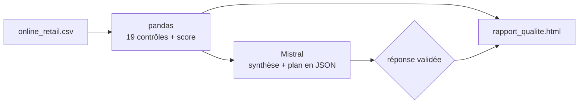

# Agent IA de qualité des données

**Audit automatique de la qualité d'un vrai jeu de transactions e-commerce, interprété par un LLM (Mistral) et restitué dans un tableau de bord HTML interactif.**

Avant de calculer un chiffre d'affaires, de segmenter des clients ou d'entraîner un modèle, il faut savoir si les données sont fiables. Ce projet automatise ce contrôle : 19 contrôles explicites, un score de qualité sur 4 dimensions, des visualisations, puis un LLM qui explique les problèmes et propose un plan de nettoyage priorisé.

## Résultats sur les données réelles

Jeu de données : [UCI Online Retail](https://archive.ics.uci.edu/dataset/352/online+retail), les transactions réelles d'un distributeur en ligne britannique (déc. 2010 → déc. 2011). On en analyse un échantillon de 81 873 lignes.

| Indicateur | Valeur |
|---|---|
| Score global | **86,4 / 100 (note B)** |
| Lignes sans aucun défaut | 52 % |
| Contrôles en échec | 12 sur 19 |
| Complétude · Unicité · Validité · Cohérence | 76,7 · 98,8 · 99,4 · 69,0 |

Ce que l'audit a révélé :

- **23 % des lignes sans identifiant client.** L'analyse client (RFM, churn) ne peut porter que sur 77 % des transactions.
- **959 lignes dupliquées à l'identique.** Leur effet sur le montant total est faible (0,13 %), mais elles faussent les volumes et le panier moyen.
- **Les quantités négatives sont en majorité des annulations, donc normales.** Seules 189 lignes négatives *hors annulation* posent vraiment problème.
- **Des frais de port, commissions et ajustements** (`POST`, `AMAZONFEE`, `M`…) sont mêlés aux ventes de produits.
- **Les contrôles techniques passent tous** (types, dates, formats) : les problèmes sont des problèmes métier, pas des erreurs d'extraction.

## Démarche : le code calcule, le LLM explique



1. **Contrôles (pandas)**, répartis en 4 dimensions : complétude (dont les « nulls déguisés »), unicité, validité (types, formats, règles métier, valeurs extrêmes) et cohérence (conventions, libellés). Chaque contrôle a une gravité métier, et sa priorité vaut gravité × taux de lignes touchées.
2. **Agent Mistral** (`mistral-small-latest`) : un seul appel, en mode JSON. Le LLM reçoit un résumé de l'audit (environ 4 Ko, pas les données brutes) et renvoie une synthèse, les risques métier, les causes probables et un plan de nettoyage avec du code pandas.
3. **Garde-fous :** le LLM ne recalcule aucun chiffre ; un identifiant de contrôle inventé est écarté ; les valeurs du jeu sont présentées comme des données, jamais comme des instructions. Sans clé API, le plan vient du catalogue de contrôles et le notebook fonctionne quand même.
4. **Tableau de bord** : un seul fichier HTML sans dépendance externe, avec le score, une section **Visualizations** (défauts par contrôle, score par colonne, manquants, évolution mensuelle), une section **Numeric distributions** (histogrammes en échelle log avec les seuils de valeurs extrêmes, statistiques descriptives), des tableaux triables, des info-bulles au survol et un mode sombre automatique.

## Lancer le projet

```bash
git clone https://github.com/veranoscience/data-quality-agent.git
cd data-quality-agent
pip install -r requirements.txt

cp .env.example .env        # puis colle ta clé dans .env (jamais dans le code)
jupyter notebook data_quality_agent.ipynb
```

Le notebook produit `rapport_qualite.html`, à ouvrir dans un navigateur. Une clé Mistral gratuite s'obtient sur [console.mistral.ai](https://console.mistral.ai/).

## Fichiers

| Fichier | Contenu |
|---|---|
| `data_quality_agent.ipynb` | Le notebook : chargement, contrôles, score, visualisations, agent Mistral, tableau de bord |
| `online_retail.csv` | Échantillon de 15 % des factures (tirage aléatoire, graine 42), en gardant toutes les lignes d'une même facture |
| `rapport_qualite.html` | Le tableau de bord généré |

## Compétences mobilisées

pandas · qualité des données (complétude, unicité, validité, cohérence) · statistiques descriptives et détection de valeurs extrêmes (Tukey sur échelle log) · matplotlib · intégration d'un LLM par API REST avec sortie JSON validée · HTML/SVG · règles métier du e-commerce (annulations, frais de service).

## Limites et pistes

- Les gravités, les pondérations et les seuils sont des choix à valider avec le métier.
- Pistes : lancer l'audit à chaque import et bloquer le chargement sous un seuil de score ; suivre les taux de défaut mois par mois ; formaliser les règles avec pandera ou Great Expectations.

---
Données : Daqing Chen, *Online Retail*, UCI Machine Learning Repository (2015), licence CC BY 4.0. DOI : 10.24432/C5BW33.
